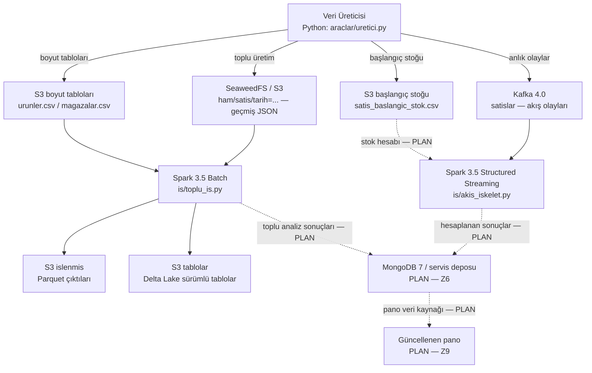

ADIM 5 — MİMARİ TASLAK (Z0)
Ders: BSM 461 — Büyük Veriye Giriş

Şablon: 2 — Gerçek Zamanlı Satış ve Stok Takibi

Şube: 2A

Grup kodu: G211210575

Tarih: 24.11.2026

Belge durumu: İlk mimari taslak; henüz uçtan uca doğrulanmış sistem değildir.
1. Amaç ve kapsam
Bu belgenin amacı veri üreticisi, Kafka, S3 uyumlu nesne deposu, Spark toplu/akış işleri, Delta Lake, servis deposu ve panonun birbirleriyle nasıl çalışacağını göstermektir. Mimari kararlarda başlangıç kitinin gerçek durumuyla ileride uygulanması planlanan adımlar ayrı tutulur.

Durumlar: MEVCUT = kitte mevcut ve temel bağlantı testi yapılmış; PLAN = henüz tam uygulama ve ölçüm yapılmamış.
2. Mimari çizim — Omurga Şeması
VS Code içinde Ctrl+Shift+V ile Markdown önizlemesini açın. Mermaid desteği yoksa diyagramı Mermaid destekleyen önizlemede açın.

Not: Kesik oklar, henüz entegrasyonu tamamlanmamış bağlantıları gösterir. Şu an çalışır durumda olduğunu iddia etmez. Başlangıç kitinin toplu ve akış kaynakları farklıdır; akış üretimi Kafka'ya, toplu geçmiş veri üretimi doğrudan S3'e yazılır.
3. Bileşenler, görevler ve durum
Katman / bileşen	Teknoloji	Görev	Durum / sorumluluk
Olay üretimi	araclar/uretici.py	Satış, iade ve stok girişi olayı üretmek	MEVCUT; ortak
Kuyruk / günlük	Kafka 4.0, satislar	Akış olaylarını bölümleyerek tutmak	MEVCUT; Z3 / Z8
Ham ve referans veri	SeaweedFS S3, ham	Geçmiş JSON, ürün/mağaza tabloları ve başlangıç stoğunu saklamak	MEVCUT altyapı; Z4
Toplu analiz	Spark 3.5, is/toplu_is.py	Temizleme, join, agregasyon, iki toplu soruya yanıt	İskelet mevcut, proje uyarlaması PLAN; Z5
Sütunlu dosya	Parquet, islenmis	Dosya biçimi ve sıkıştırma deneyleri	Temel test doğrulandı, proje deneyi PLAN; Z2
Tablo biçimi	Delta Lake, tablolar	Sürüm geçmişi, time travel ve atomik yazma deneyi	Temel test doğrulandı, proje deneyi PLAN; Z7
Akış analizi	Spark Structured Streaming, is/akis_iskelet.py	Kritik stok uyarısı ve son bir saatlik net ciro	İskelet mevcut, proje uyarlaması PLAN; Z8
Servis deposu	MongoDB 7 (öneri)	Pano için sorgulanabilir güncel sonuçları saklamak	PLAN; Z6
Pano	Python/R ile güncellenen grafikler (öneri)	Stok uyarıları ve mağaza ciro görünümü	PLAN; Z9

Not: Kullanılacak yazılımların sürümleri ve servis sayıları son raporda çalıştırılan Docker imajları ve komutlarla doğrulanmalıdır. Başlangıç kitinde Kafka tek düğüm, Spark local[*], S3 tek düğüm olarak sadeleştirilmiştir.
4. Garanti Tablosu (Z0) — ilk sürüm
Her ok için kopya sayısı, sıra güvencesi ve ağ bölünmesinde olabilecek sonuç ayrı ayrı değerlendirilmektedir. Buradaki teknik açıklamalar henüz kanıtlanmamış uçtan uca garanti olarak yorumlanmamalıdır.
Veri akışı	Kopya / dayanıklılık	Sıra garantisi	Ağ kesintisi / arıza etkisi
Üretici → Kafka	Kitte tek broker, varsayılan RF=1; üretici varsayılan acks=all ve idempotent	Kafka'da yalnızca aynı bölüm içinde sıralama; üretici varsayılan anahtarı urun_id	Tek broker erişilemezse üretim durabilir, RF=1 veri kaybına karşı yedek sağlamaz
Kafka → Spark Streaming	Tek broker; Spark checkpoint ayarı projede netleştirilecek	Bölüm içi sıra korunabilir; farklı bölümler arasında global sıra yok	Okuma durabilir; yeniden başlatma, offset/checkpoint ve tekrar işleme test edilecek
Üretici → S3 ham	Yerel tek S3 düğümü, replika garantisi yok	Dosyalar üzerinde olaylar arası genel sıra garantisi yok	Depo erişilemezse üretim başarısız olabilir; yeniden üretim/yeniden deneme davranışı kontrol edilecek
S3 ham/boyut → Spark Batch	Yerel tek S3 düğümü	Analizde açıkça sıralama yapılmazsa sonuç satırı sırası garanti edilmez	Veri okuma durur, batch işi başarısız olabilir; kaynak korunmalıdır
Spark Batch → S3 Parquet	Yerel tek S3 düğümü; basit dosya yazımı işlem düzeyinde ACID sağlamaz	Çıktı dosyalarının yazım sırası garanti edilmez	Yarım kalan çıktı riskine karşı deney ve güvenli yazım stratejisi gerekli
Spark Batch → Delta Lake	Delta transaction log atomik commit sağlar; S3 düğümü yine tektir	Tablo sürümleri sıralıdır, olayların küresel işlenme sırası değildir	Depo erişilemezse işlem başarısız olabilir; atomik yazma deneyinde test edilecek
Batch / Streaming → MongoDB	PLAN; veri modeli, kopya sayısı ve idempotent yazım belirlenecek	İşlem sırası ve tutarlılık sözleşmesi henüz doğrulanmadı	Veritabanı erişilemezse kuyruklama/yeniden deneme yaklaşımı gerekli
MongoDB → Pano	PLAN; canlı güncelleme ve ölçüm yok	Kullanıcıya her zaman en son olayın görünmesi garantisi henüz yok	Pano eski değer gösterebilir veya sorgu başarısız olabilir

Kafka — Mevcut Yapı ve Garantiler
Kafka konusu: satislar

Gerçek sistem çıktısından elde edilen değerler:
- PartitionCount: 3
- ReplicationFactor: 1
- Broker / Leader: 1
- ISR: 1
Üç partition da aynı broker üzerinde bulunmaktadır.

Kafka, aynı partition içindeki kayıtların sırasını korur.
Ancak farklı partition'lar arasında genel bir sıralama
garantisi yoktur.

ReplicationFactor=1 olduğu için broker arızasında
devreye girecek ikinci bir kopya bulunmamaktadır.

Bu yapı ders projesinin tek bilgisayarlı deney ortamı
için kullanılmaktadır. Gerçek üretim sisteminde
çoğaltma, kalıcı depolama ve hata toleransı ayrıca
tasarlanmalıdır.

Senaryo kartındaki "hiçbir olay kaybolmamalı"
koşulunun sağlandığı henüz kanıtlanmamıştır.

Kafka bölüm anahtarının ve bölüm sayısının
nihai seçimi Z3/Z8 kapsamında ölçülecektir.
Kritik sınırlamalar
1. acks=all ve üretici idempotentliği, tek Kafka broker'ıyla veri kaybını imkânsız kılmaz ve uçtan uca exactly-once garantisi değildir.
2. Satış şablonu üreticisi varsayılan Kafka anahtarı olarak urun_id kullanır. (magaza_id, urun_id) bazında stok hesabının sırası ve olası çarpıklık Z3/Z8'de yeniden incelenecektir; mevcut üretici anahtarının değiştiği iddia edilmez.
3. siparis_id farklı üretici çalıştırmalarında yeniden kullanılabildiği için tek başına güvenli bir tekrar giderme anahtarı olduğu kabul edilmez.
4. Spark checkpoint, hedefe idempotent/atomik yazma ve kaynak olay kimliği birlikte incelenmeden sistem için "exactly once" yazılmayacaktır.
5. Yerel tek düğümlü deney düzeneği ile üretimde önerilecek yedekli mimari birbirine karıştırılmayacaktır.
5. Senaryo kartına dayalı tasarım koşulları
Koşul	Grup değeri	Mimaride etkisi
Ortalama olay hızı	200 olay/s	Normal yük ve ham depolama tahmini
Tepe yükü	800 olay/s	Kafka/Spark işleme ve tamponlama kapasitesi tepeye göre test edilecek
Uyarı gecikmesi	En fazla 120 saniye	Stok alarmı ve panonun ilk sonucu için ölçüm hedefi
Geç olaylar	%15, en fazla 30 dakika	Watermark ve düzeltme/yeniden hesaplama planı
Kayıp sınırı	Hiçbir olay kaybolmamalı	Geç olaylar ayrı korunmalı; kayıp/tekrar testleri yapılmalı
Ham saklama	1095 gün	Uzun süreli nesne depolama planı
Servis sorgusu	p99 <= 200 ms	MongoDB sorgu ve indeks testinde ölçüm hedefi

Açık karar: 120 saniyelik uyarı süresi, en fazla 30 dakika geç gelen olaylar ve sıfır kayıp gereksiniminin birlikte nasıl yorumlanacağı henüz kesinleşmemiştir. Olası çözüm ilk sonucu hızlı sunup geç gelen olayla daha sonra düzeltmektir; ancak öğretim üyesinin yanıtı ve uygulama ölçümü beklenmektedir. 120 saniye garantisi verilmez.
6. Analiz soruları ile mimari bağı
Batch 1: Son 14 günde en çok satılan ürünler ve kategoriler hangileridir?

Kaynak: S3 geçmiş olayları + urunler.csv. Sonuç: Parquet/Delta ve grafik.

Batch 2: Mağazalara göre iade oranları nasıl değişmektedir?

Kaynak: S3 geçmiş olayları + magazalar.csv. Sonuç: Parquet/Delta ve grafik. İade oranının tanımı kayıt altına alınacak.

Streaming 1: Hangi mağazalarda hangi ürünlerin stokları kritik seviyenin altına düşmüştür?

Kaynak: Kafka satislar + başlangıç stoğu. Eşik değeri, iade kuralı, tekrarlar ve geç olay düzeltmesi henüz kesinleşmedi.

Streaming 2: Mağaza bazında son bir saatlik net satış cirosu nasıl değişmektedir?

Kaynak: Kafka satislar. Event-time pencere, geç olay ve idempotent çıktı kararı henüz kesinleşmedi.
7. İş bölümü ve entegrasyon
- Üye 1: Z1 desteği, Z2, Z4, Z5, Z7 — ham veri, Parquet, Delta, toplu analiz ve ölçüm.
- Üye 2: Z3, Z6, Z8, Z9 — Kafka bölümlendirme, servis deposu, akış işi ve pano.
- Üye 3: Z10 — veri kalitesi, grafikler ve rapor birleştirme (zaman kısıtı nedeniyle Z1'in ilk çalışması üye 1 tarafından üstlenildi).
- Ortak: Z0 mimari, Z11 kırılma deneyi, entegrasyon ve sunum.
GitHub üzerinden taslak paylaşılacak. Grup üyeleri aynı veri sözlüğü, olay türleri, iş kuralları ve çıktı şemasını kullanacaktır. Taslak üzerinde fiilî grup uzlaşması ve entegrasyon doğrulaması henüz kaydedilmedi.
8. Kontrol / sonraki işler
- [x] Grup kodu ve şablon netleştirildi.
- [x] Kafka, S3, DuckDB ve Spark temel doğrulama testleri önceki adımlarda geçti.
- [x] İlk veri akışı diyagramı çizildi.
- [x] İlk garanti tablosu hazırlandı.
- [ ] Aktif Kafka bölüm/replica ayarı komut çıktısıyla belgelenmeli.
- [ ] MongoDB ve pano seçimi uygulamada kesinleştirilmeli.
- [ ] Çıktı şeması ve magaza_id/`urun_id` anahtar sözleşmesi ekipçe netleştirilmeli.
- [ ] İade, tekrar ve geç veri iş kuralları doğrulanmalı.
- [ ] Her bileşen için gerçek yeniden başlatma/ağ kesilmesi testleri yapılmalı.
- [ ] Son mimari, raporun 3. bölümüne ve sunumun ilk slaydına taşınmalı.
9. Kaynaklar
- Öğretim üyesinin BSM 461 dönem projesi yönergesi: Adım 5 (s. 10–11), Z0 (s. 17–18).
- Resmî başlangıç kiti: https://github.com/sumeyyekaynak/bsm461-proje-kit
- Grubun önceki adımlarda ölçülen senaryo ve makine değerleri.